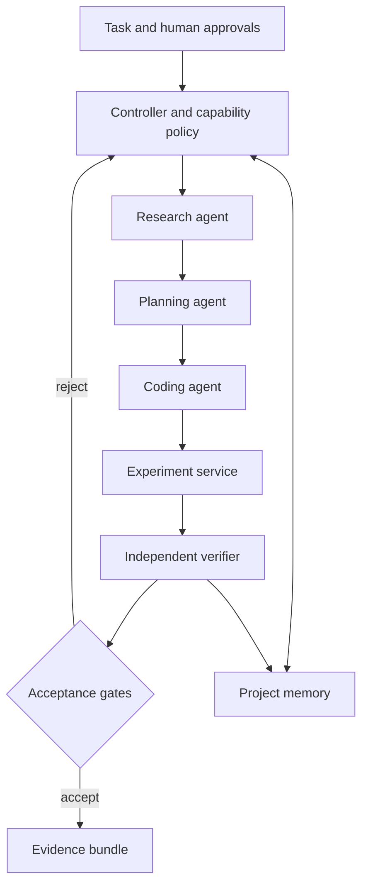
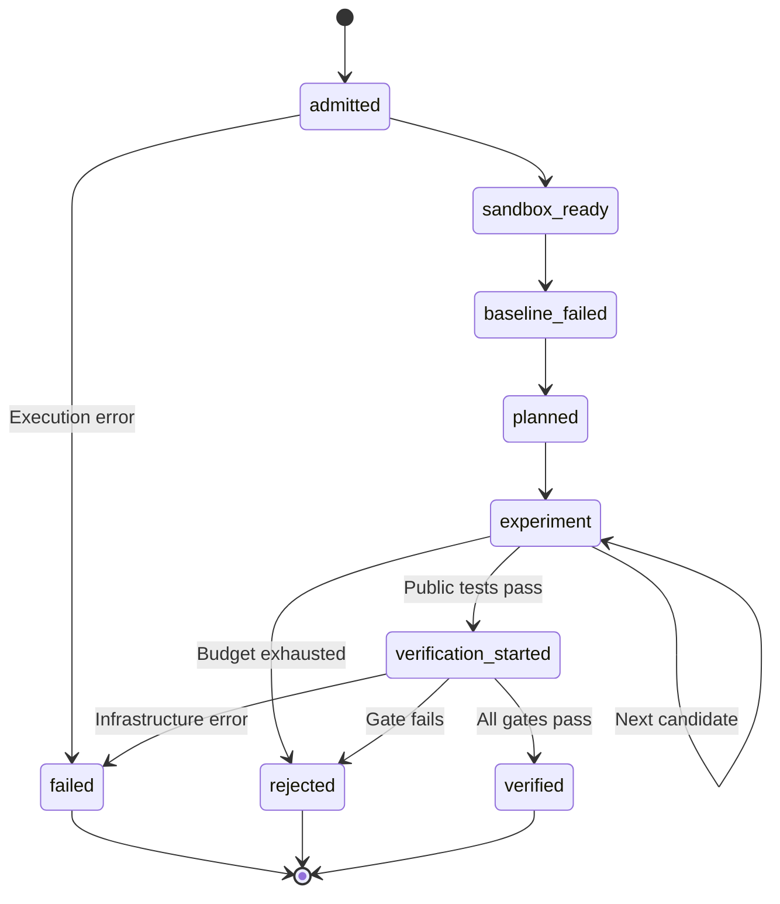

# Architecture

## Principle

Proposal generation and completion authority must be separate. A proposal is
untrusted data. The controller owns capabilities, snapshots and budgets; a
separate verifier owns test admission, oracle answers and the verdict. Memory
stores evidence with provenance and never upgrades an unverified claim to fact.

## Target modular multi-agent design

All role messages should carry schema version, task/run/attempt IDs, input
revision, parent evidence references, budget and required capabilities.
Repository prose never grants a capability. Research results include source
URLs, retrieval timestamps and versions; memory must distinguish observations,
hypotheses, rejected attempts and accepted evidence.

| Component | Responsibility and access | Milestone 1 implementation |
|---|---|---|
| Controller | State, immutable input identity, budgets, capability checks | `workflow.py`; sequential bounded workflow |
| Research | Read-only sources and provenance; no execution rights | Human-assisted source comparison in docs; runtime agent proposed |
| Planning | Decompose work and specify acceptance gates | Structured baseline plan and public failure context; LLM planning proposed |
| Coding | Return source-only proposal with preimage digest and rationale | `agents.py`: mutation baseline, optional Ollama transport |
| Experimentation | Apply admitted changes to disposable copies; run tests | `sandbox.py` + `worker.py`, 24-attempt maximum |
| Verification | Recreate baseline, preserve tests, independently check candidate | Separate `verifier.py` process and fresh restricted workers |
| Memory | Persist runs, event provenance and failure history | `memory.py`: SQLite + JSONL export; semantic retrieval proposed |

No runtime role can write to GitHub, merge or deploy. Future human authorization
must bind a reviewed diff and exact destination; it cannot be inferred from a
model's text. There is no production adapter in this release.

## Executable workflow and trust boundaries

1. **Admission:** read three bounded files; reject links and unsupported source.
   Separately validate the supervisor-owned oracle. Snapshot the input and hash
   the AEL runtime source. The input repository remains untouched.
2. **Preflight:** in an isolated Python worker install `no_new_privs`, resource
   limits and a default-deny seccomp filter. Demonstrate denied read, write,
   socket, fork and exec operations. Failure stops the workflow.
3. **Reproduction:** execute the real public unittest source against the original
   function. Require at least one assertion failure and zero test errors.
4. **Proposal:** pass task, source, public tests and baseline output to the chosen
   proposer. Never pass oracle cases. Baseline enumerates one-operator AST edits;
   Ollama makes one JSON proposal. The proposal includes path, preimage hash,
   replacement, rationale and provider identity, never an authoritative verdict.
5. **Experiment:** validate source policy and preimage; test a candidate in a
   fresh worker. Invalid or failed candidates are logged and can be followed by
   another attempt. The original tests are always used.
6. **Independent verification:** launch a separate trusted process with clean
   environment and package path. It checks snapshot/oracle digests, unchanged
   tests/task, nonempty patch and source admission. It reproduces the failure,
   runs candidate public tests twice, and calls original/candidate functions in
   fresh workers per oracle input. Workers receive arguments, never expected
   answers. The verifier compares numeric results externally, including cases
   already passing before repair. It requires an oracle-detected original bug.
7. **Evidence:** persist verdict, observations, diff, source snapshots, event
   chain and artifact digests. A fresh `verify` command checks content integrity
   and reruns behavior against the separately supplied oracle.

Any active stage can fail or be explicitly marked aborted after a controller
crash. The diagram shows representative failure edges; SQLite stores the exact
stage. A retry uses a new ID and links an unsuccessful run of the same task.

## Limits of independence

Verification is independent of proposer decisions and worker test claims, but
it is not an independent institution or tamper-proof hardware boundary. The
operator trusts AEL code, the Python/kernel runtime, task specification and
oracle. The same host owner can rewrite them. Hashes help detect changed bytes;
they cannot prevent that owner from rewriting hashes. Production needs separate
identities/storage, signed provenance, externally pinned inputs and a hardened
general-purpose execution backend before accepting arbitrary code.
